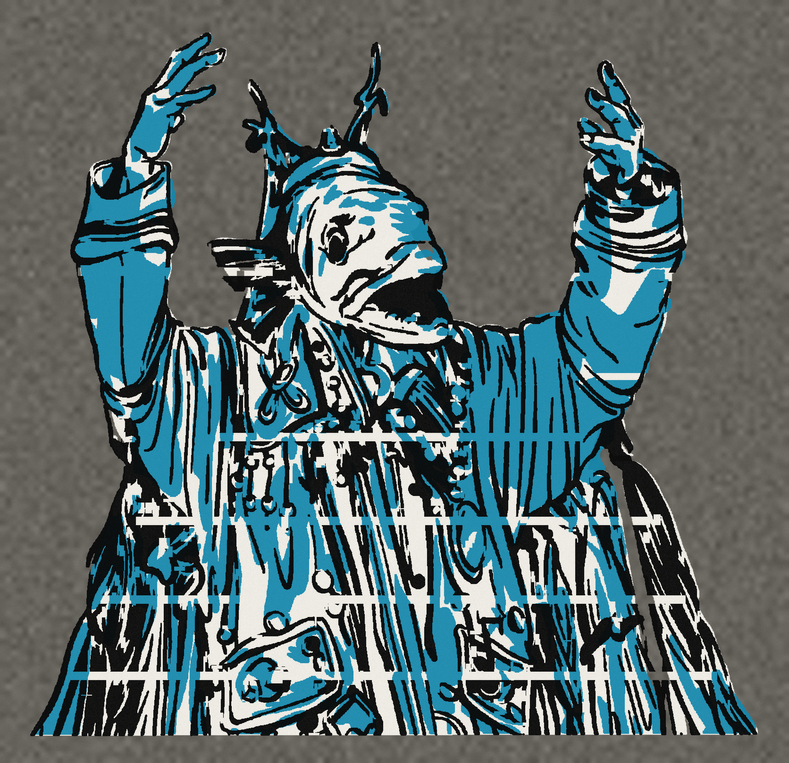

  

# mountain-shaman

**山中萨满**是一套仍在生长的原创角色与世界观项目。鱼首、人身、仪式服与工程道具共同构成角色的外形；黑、白、灰建立主体，每个阵营只保留一种标志色。项目同时发展数字插画、人物档案、文化研究与可实际制作的多层 stencil。

> 蓝色穿越世界，红色重造世界，黄色把不断进入世界的新关系安置下来。

## 世界观

群山并不是静止的岩体。它们内部残留着古海的水路、受压发热的矿脉，也保存着迁徙、死亡与聚落更替留下的名字。山中的异变会同时表现为水路中断、结构破裂和关系失序；萨满的职责，是让人、山体与不可见者重新建立可以共同生活的秩序。

这个世界没有一套统一的萨满教义。三大阵营代表三种不同的认识方法：有人倾听并穿越流动关系，有人加固并重新制造物质结构，有人辨认来路、命名存在并安排席位。面对同一场山腹异变，三派可能提出三种都自洽、却彼此冲突的诊断。

现实世界中的萨满传统为项目提供身体观、材料关系、仪式组织和社会角色等结构参照，而不是可直接复制的服装目录。真实民族、神名、神歌、祭坛和完整仪式不会被改名搬入虚构世界。

## 三盟历史 / History of the Three Alliances

### 共鼓时代

三个阵营原本同属“行山者”的共同祖制，并不是三个天然敌对的民族。早期行山者相信山是一具缓慢呼吸的身体：河流是血，洞穴是肺，矿脉是骨，森林与兽群则承载不断脱落、重新生长的记忆。

他们用绳结记录道路，用金属片承担誓言，用鼓皮提醒自己世界仍然活着。每年，各地行山者都会在中央山口的旧鼓庭会合，把一段绳、一枚金属片和一块鼓皮放在同一张黑毡上。完整的共同祖纹“三岔鱼脊”，也来自这个时期。

### 三种地理与地方知识

气候变化、人口扩散和旧水道迁移，使行山者逐渐长期驻留在三种不同的环境中。阵营最初不是政治派别，而是三套应对地方问题的工作方法。

- **北境针叶林与河网**不断受到冻土、融雪、河流改道和长距离迁徙影响。当地行山者发展出倾听水脉、辨认季节路径、编结和留下“此处仍可通过”标记的传统，后来成为守潮者。
- **西南草原、裸岩与矿山**直接面对风、旱、雷火、温差和结构损坏。当地行山者逐渐成为炉匠、桥梁建造者、矿井维护者与山体测压人，后来成为赤脉者。
- **东部森林、河谷与移民聚落**不断接纳猎人、农耕者、迁入家庭和新的信仰关系。当地行山者发展出辨认来历、记录谱系、安排席位与完成送离的制度，后来成为合祀者。

这不是环境决定论。地理只提供压力与材料；三种体系来自人们在不同压力下作出的制度选择。

### 第一次山腹危机

阵营真正分裂，发生在“第一次山腹危机”。北境融雪提前、旧河道消失；西南矿井、水井和山体结构连续崩塌；东部则接纳了大量失去家园、祖席与地方神灵位置的人。三地的灾难沿残存道路同时涌向中央旧鼓庭。

封潮议会上，行山者作出了三种都成立、却无法同时优先执行的诊断：

- 北境行山者认为山中循环被阻断，必须拆开堤坝、迁移营地并重新打开通路。
- 西南行山者认为山体已经失去承力结构，必须先架梁、封井并固定裂隙。
- 东部行山者认为失所者、死者和地方神灵已经失去名字与位置，必须先建立新的谱系和共同生活秩序。

资源不足使三方无法依次完成所有工作。守潮者的前身拆开北堤，赤脉者的前身同时封井架梁，合祀者的前身则把临时安置地迁往尚未完成加固的东坡。三方没有宣战，只是同时做了各自认为不能等待的事。

### 断山夜与三种颜色

第十三天夜里，改道的积水撞上刚刚封固的井壁。铁梁把压力传向临时安置地，中央山口随之断裂。三方都在救人，也都认为另外两方让灾难变得无法挽回。

断山夜之后，三种颜色第一次获得明确的公共含义：

- 蓝色标记仍然能够通行、但必须持续复核的道路。
- 红色标记正在受压、发热或需要承担重量的结构。
- 黄色标记已经进入共同生活、但仍需被命名和安排位置的关系。

### 《三盟旧约》

第二次议会没有恢复统一的萨满组织。幸存者签订《三盟旧约》，把山域划分为三类责任，而不是三块互不往来的国土：守潮者维护通路，赤脉者重造结构，合祀者安置关系。一个人的阵营也不再完全由出生决定，而由他愿意承担哪一种公共责任决定。

三个阵营随后发展出不同的知识与图像传统：守潮者把绳结和路线标记发展为允许覆盖、修改的丛林涂鸦；赤脉者以工程图、受力标记和材料样片记录建造知识；合祀者则用能够叠画、续写却不能无声抹去来历的公共壁画保存关系。

三方始终相互依赖：赤脉者建造的桥让守潮者跨越断谷，守潮者的水文判断决定桥能否活过下一个春天；战争、灾荒和工程迫使陌生人重新聚居时，合祀者负责让不同祖先、神灵与生活方式获得可以持续的边界。

### 当代异常

如今，《三盟旧约》正在失效。北境路标开始指出彼此矛盾的方向；中央矿脉中出现不像天然形成的“空骨”；东部壁画上则不断出现无人添画、却能被多人同时叫出名字的新面孔。

三种异常指向同一个可能性：第一次山腹危机从未真正结束。三个阵营只是把同一处伤口，分别命名为堵塞的水路、断裂的骨架和无处安置的人。

## 三大阵营

### I · 守潮者 / Tide Keepers

**标志色：钴蓝**  
**现实结构参照：以鄂温克为中心的北亚萨满传统**

守潮者相信山腹仍保存着古海的潮路。身体是一副能够接收细微信号、进入不可见路径的“第二身体”；轻金属、绳索、鼓膜与活动环像鳃、触须和延伸的感官。他们在河口、洞穴、雪线和迁徙路径活动，以听、触、测、引和编结寻找中断的水与记忆。

他们也掌握水路勘测、地下水维护、渔汛与融雪判断、渡运导航，以及绳结、鼓膜、薄金属环和集雾器等轻型水工手艺。钴蓝不是装饰，而是流动关系被听见、测量或重新接通的标记。

### II · 赤脉者 / Red Veins

**标志色：冷猩红**  
**现实结构参照：蒙古—布里亚特传统中金属、锻造、祖灵与山地力量的关系**

赤脉者把世界理解为一副可以加固、截断并重新制造的物质结构。身体既是铁骨，也是承压工具；厚铁片、铆钉、夹具、压力膜与烧结绳把萨满和山体固定在同一受力系统中。他们进入矿脉、火场、裂隙和锻造工坊，以钉、压、锻、拉、切与封合处理危险节点。

采矿、选矿、冶炼、锻造、铆接、炉场维护和承压施工既是仪式，也是生计。冷猩红只出现在发热、受压或正在重新接合的位置——那是山体被迫改变时留下的可见应力。

### III · 合祀者 / Confluence Keepers

**标志色：赭黄**  
**现实结构参照：中国东北多民族长期交融形成的复合萨满谱系**

合祀者是分支最多的体系。其结构参照包含狩猎民族的山林与路径知识、满族家祭与野祭、中国朝鲜族支系，以及后期汉族民间信仰在东北地区的接触与重组。身体是祖灵、兽灵、地方神和迁徙记忆相遇并重新排座的场所；服饰上每个新增部件，都代表一条关系被接纳。

他们活动于宗族家屋、火塘、猎场边界、山口、边镇与移民聚落，负责认、请、迎、命名、分座、续谱和送行。辨踪狩猎、林地路线管理、家谱记录、织带缝制、木架与纸桥制作，以及婚盟见证、争端调解和新居民安置，共同构成这个阵营复杂而不断增生的社会网络。

## 山中萨满 stencil 项目

stencil 项目尝试把人物插画转化为可分层喷涂、可重复套色、并能用桌面 3D 打印机制作的实体模板。目标不是把 PNG 一键矢量化，而是在尽量保留原画动作、轮廓和笔触节奏的同时，解决孤岛、断桥、细线、套色误差和大幅面分块等制造问题。

### 三层结构

| 层 | 图像职责 | 制造关注点 |
|---|---|---|
| Layer 1 | 主体底色与大轮廓 | 连续结构、稳定外框、主要开孔 |
| Layer 2 | 蓝色体积块与视觉节奏 | 套色边界、孤岛连接、局部越界 |
| Layer 3 | 黑色线稿与深色细节 | 最小负形线宽、桥位与细节强化 |

目前的工程方向以 Bambu Lab A2L 的打印范围与分块需求为基础：模板厚度约 `0.8–1.0 mm`，外框约 `15–20 mm`，最小桥宽建议不低于 `2.5 mm`，关键开孔不小于 `2 mm`，并使用三点或三十字 registration 完成套色对位。实际参数仍需依据最终尺寸、材料、喷涂方式、切片结果和试喷效果复核。

当前流程是：原始 PNG → 分层几何整理 → SVG 中间文件 → 真实开孔 STL → 单层检查 → 叠色模拟 → 切片与试印。SVG 只是工程中间态；只有经过桥位、孤岛、最小特征、对位和实物试喷验证的 STL，才能被视为可制造版本。

## 项目内容

- `dist/`：三大阵营与人物档案网页
- `docs/readme-assets/`：README 使用的项目图像
- `.github/workflows/pages.yml`：GitHub Pages 发布流程

项目仍在持续扩充角色、阵营内部支系与 stencil 工程文件。网页和视觉设定展示创作成果；涉及真实文化的文字则坚持区分研究参照、原创转译与尚待验证的制作结论。
